# HairPath

**From the hair you have to the hair you want.**

HairPath is a mobile-first web app (PWA) built on **9 YouCam AI hair and beard APIs** plus the File API. You try any cut on your own face, see how far it is from your hair today, and get a plan your barber or stylist can use, in their language. Then HairPath walks the road with you: check-in photos measured by YouCam, a haircare routine built for your hair, trim reminders, and a live link your barber answers from their phone.

Your guide is **Pip**, a lion-cub road-tripper with a sunset mane and a map-pin tail. Pip waits in the corner of every page with help for the step you're on, speaks up when you seem stuck (an error, a slow render, a long pause), and, when the site has a Groq key, answers questions you type.

> HairPath is a planning tool. Previews are references, not guarantees. It does not predict how fast hair grows, and it is not medical advice.

<p align="center">
  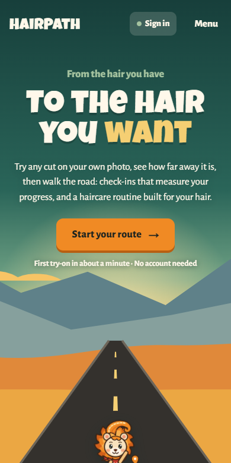
  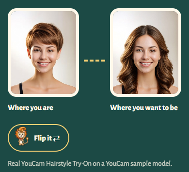
  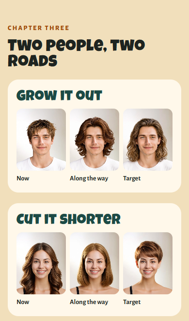
</p>

**Built for the [YouCam API Skin AI & eCommerce VTO Hackathon](https://youcam-api-skin-ai-ecommerce.devpost.com/)** (Perfect Corp. × Devpost). See [How HairPath meets the hackathon rules](#how-hairpath-meets-the-hackathon-rules) below.

| | |
| --- | --- |
| **Live demo** | https://hair-path-youcam.vercel.app (no login needed) |
| **Demo video** | ‹add the YouTube link› |
| **Platform** | Mobile web (PWA) on a phone; also works on a laptop with a webcam |
| **YouCam APIs** | Hair Length Detection, Hair Type Detection, Hair Frizziness Detection, Hair Density Detection, Hairstyle Virtual Try-On, Hair Extension, Beard Style Generator, Bangs, Hair Color, plus the File API |

---

## The problem

Most bad haircuts come from a bad conversation, not bad cutting. An inspiration photo can't say *"my hair is nowhere near that long"*, *"no perms"* or *"I have five minutes in the morning"*. Try-on apps make it worse: they show a perfect destination with no sense of how far away it is, and nothing happens after the photo.

HairPath shows the **path** between the two, then helps you walk it.

## How it works

### 1. Consult (`/consult`)

| Step | What happens | YouCam API |
| --- | --- | --- |
| **You** | One photo with a framing guide, a 3-second timer and a light hint, or an upload | File API |
| **Pick** | Your current length is measured in the background while you browse 58 cuts in a photo grid. You choose Men's, Women's or All; nothing is guessed from your photo. Once measured, the cuts sort into **Ready now**, **Grow one stage** and **Big change** | **Hair Length Detection** |
| **Try on** | Each cut wipes onto your own face in a full-width before/after slider. Every look collects in a **lookbook** to compare side by side. **Finish the look** adds one of 15 beards, 10 fringes per list or 9 colours, each with what to ask for | **Hairstyle Virtual Try-On**, **Beard Style Generator**, **Bangs**, **Hair Color** |
| **Route** | Your face at every stop on a painted road: now → along the way → grown → destination. A plain answer (*Ready for your next appointment*, *Grow it out first*, *Cut it shorter*, *Check with your stylist first*) with the reasons, the cuts to ask for along the way and, from short hair up, **your own hair, grown out**. An optional **hair check** (three hands-free photos) reads texture, frizz and density, and the route and routine use them | **Hair Extension**, **Hair Type Detection**, **Hair Frizziness Detection**, **Hair Density Detection** |
| **Document** | A one-page plan for the chair: **what to ask for, in barber language**, in order from the next appointment, then your questions and a note. Share it, download it or save it to **My plans** | Canvas, Web Share API |

<p align="center">
  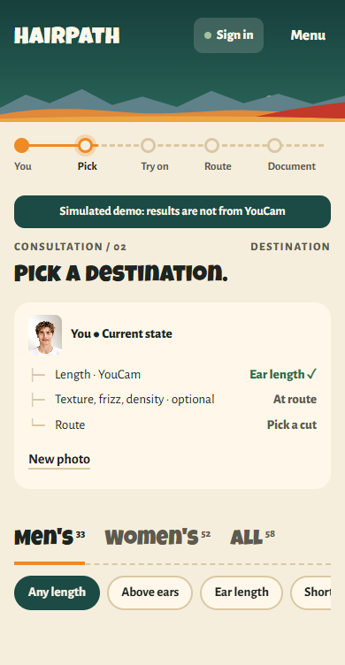
  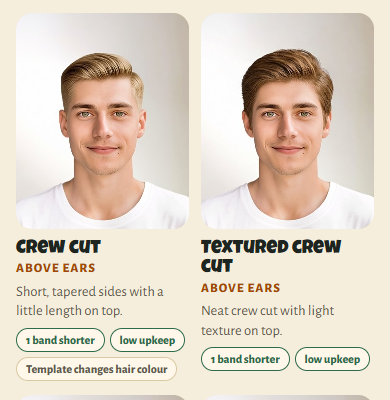
  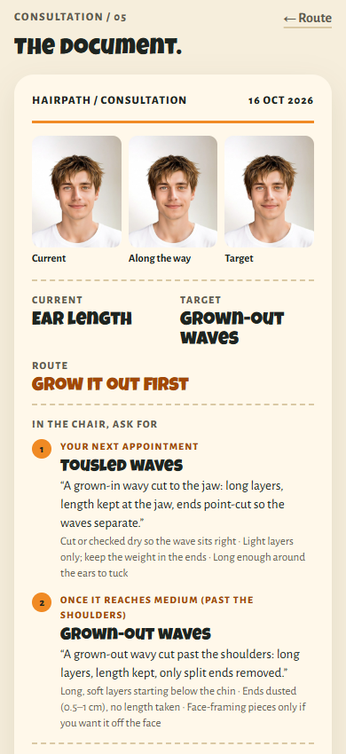
</p>

### 2. Send it to your barber, live

**Create barber link** on the document makes a link and a QR code. The barber opens it on their phone with no app and no account, sees the plan in chair language with your previews, and taps **Can do**, **Let's talk** or **Not yet** on each step, or sends a note. On your screen, "Your barber opened it" and every answer appear as soon as they tap (Supabase Realtime). **Stop sharing** deletes the link.

<p align="center">
  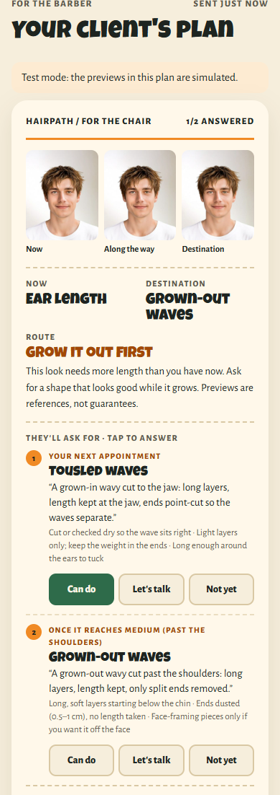
  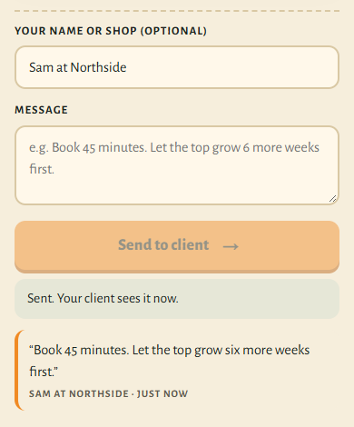
  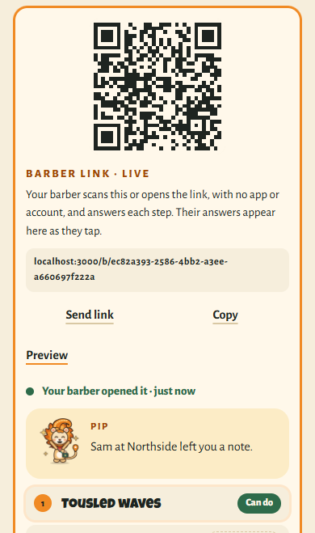
</p>

### 3. Walk the road (`/journey`)

**Start my journey** on the document turns the plan into a journey:

- **The road.** Every stop shows its YouCam preview: where you started → along-the-way cuts → your hair grown → the destination. Pip stands where you are.
- **Check-ins.** Every few weeks you take one new photo. **Hair Length Detection** measures it again, and **Hairstyle Try-On re-renders your destination on that photo**, next to the day-1 render. You move along the road when your length band changes or when you log the cut. Progress never goes backwards.
- **Your pace** comes from your own measurements ("1 band longer in 9 weeks") and is never predicted.
- **Haircare routine.** Six taps (texture is skipped when the hair check already measured it) give you a daily, wash-day, weekly, monthly and this-stage routine. Every step shows the rule behind it. Products are named by type, never by brand.
- **Today's checklist** with a streak, **trim planning**, and **Add reminders to my calendar** (an `.ics` file).

<p align="center">
  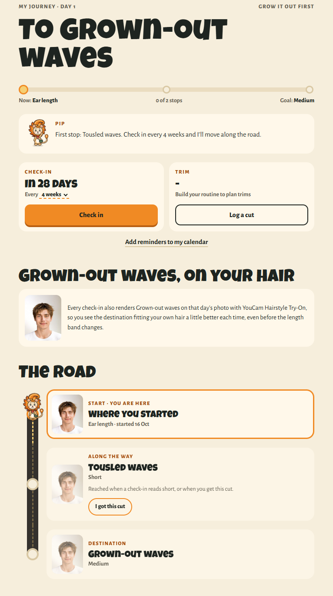
</p>

### 4. My plans, account and community pulse

- **My plans (`/plans`):** saved documents grouped by month, kept on your device. Shared plans show the barber's live answers.
- **Account (`/account`, optional):** never required. An emailed magic link syncs plans and journeys between your phone and laptop.
- **Community pulse:** real try-on counts per cut, with no photos and no users: **Popular this week** in the grid, "N tried this week" on each card, and a live counter on the home page.

<p align="center">
  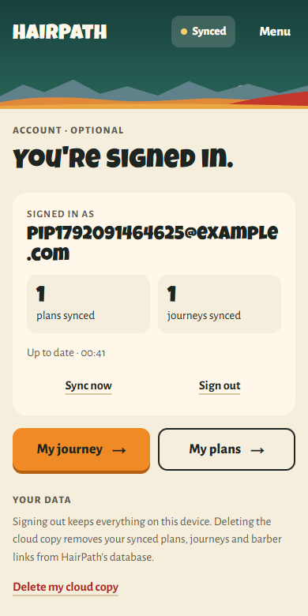
</p>

<sub>Screenshots: the home-page images (first row) are real YouCam Hairstyle Try-On results on a YouCam sample model photo. The app screens were captured by the automated test `npm run e2e:cloud`, which runs with `YOUCAM_MOCK=1` so it spends no API units. In that mode every preview is the test photo and the app labels the screens "Simulated demo". In normal use each preview is a real YouCam render.</sub>

## Built on YouCam AI

| API | Endpoint | Used for |
| --- | --- | --- |
| File API | `POST /s2s/v2.0/file` → `PUT` presigned URL | Registering photos |
| AI Hair Length Detection v1.0 | `/s2s/v2.0/task/hair-length-detection` | Your starting length, and every journey check-in |
| AI Hair Type Detection v1.0 | `/s2s/v2.0/task/hair-type-detection` | Natural texture (straight → coily) from three angles, for the route and the routine |
| AI Hair Frizziness Detection | `/s2s/v2.0/task/hair-frizziness-detection` | Frizz from the hair-check photos, for rule R8 and routine step RT16 |
| AI Hair Density Detection | `/s2s/v2.0/task/hair-density-detection` | Density from a head-lowered photo, for rule R7 and routine step RT17 |
| AI Hairstyle Virtual Try-On v2.1 | `/s2s/v2.1/task/hair-transfer` | The target and along-the-way previews, and the destination re-rendered at every check-in |
| AI Hair Extension VTO v1.0 | `/s2s/v2.0/task/hair-ext` | "Your hair, grown" preview |
| AI Beard Style Generator | `/s2s/v2.0/task/beard-style` | 15 beard styles on top of the haircut try-on |
| AI Bangs | `/s2s/v2.0/task/hair-bang` | 20 fringes (10 Men's, 10 Women's) on top of the try-on |
| AI Hair Color | `/s2s/v2.0/task/hair-color` | 9 colours on top of the try-on |

All calls go through Next.js route handlers on the server, so the API key never reaches the browser. Tasks are polled, and a page refresh resumes a running task instead of paying for it again. A full consultation with the hair check uses about 8–9 units, and each check-in about 4 (a length measurement plus the destination re-render). Details: [docs/YOUCAM_APIS.md](docs/YOUCAM_APIS.md).

## How HairPath meets the hackathon rules

The [official rules](https://youcam-api-skin-ai-ecommerce.devpost.com/rules) ask for a working web or mobile app that "integrates at least one Perfect Corp. YouCam API" and shows "clear consumer or eCommerce value". The submission period runs from 29 Sep 2026, 12:00 pm ET to 2 Nov 2026, 11:45 am ET.

### Project requirements

| Rule | How HairPath meets it |
| --- | --- |
| **What to create:** a working application that integrates at least one YouCam API and shows clear consumer or eCommerce value | 10 YouCam endpoints, all from the **Hair & Beard** category the judging criteria name. Consumer value: people know before the appointment whether their hair is ready, what to ask for at each visit, and how to care for it while it grows. Retail value: salons and barbers get a client who arrives with a plan, and the routine names product types to buy at each stage |
| **Functionality:** installs and runs consistently on its intended platform, and works as shown in the video and description | A PWA for phones, also usable on a laptop. CI runs typecheck, 64 unit tests and a production build on every push. `npm run e2e` walks the whole flow in a real browser with real YouCam calls, and `npm run e2e:cloud` drives a client phone, a barber phone and a laptop at the same time. Every YouCam error code maps to a plain-language fix |
| **New and existing:** newly created, or significantly updated after the submission period starts, with an explanation | A first MVP was built on 28 Sep 2026, before the window opened. Everything since 29 Sep is logged by date in [CHANGELOG.md](CHANGELOG.md): the rebuilt flow, the journey, 7 more YouCam APIs, finish-the-look, the hair check, the live barber link, sync and the community pulse |
| **Third-party integrations:** must be authorized under each tool's terms or licence | YouCam APIs under YouCam's and Perfect Corp.'s Terms of Service. Supabase (optional) on its free plan. Open-source packages under their own licences (Next.js, React, `@supabase/supabase-js`, `qrcode`). Fonts (Alegreya Sans, Luckiest Guy) from Google Fonts under open licences. See [Third-party assets](#third-party-assets) |

### Submission requirements

| Rule | How HairPath meets it |
| --- | --- |
| **Code repository** with all source, assets and instructions, public with relevant licensing or private and shared with contact_event@PerfectCorp.com | This repo holds all source, the catalog assets, the database migration and the setup steps below. Public under the [MIT licence](LICENSE) |
| **Text description** of features, functionality and consumer or eCommerce value | [docs/SUBMISSION.md](docs/SUBMISSION.md), ready to paste into Devpost |
| **Demo video, 1–3 minutes,** end to end, explaining the YouCam APIs used, showing the app on its intended device, public on YouTube or Vimeo, with no third-party trademarks or copyrighted music | Planned in [docs/DEMO_SCRIPT.md](docs/DEMO_SCRIPT.md): recorded on a phone, naming each YouCam API as it appears, no music or logos that need permission |
| **Testing access,** free and without restriction until judging ends | The live demo needs no login or account. Sign-in is optional and only adds sync. Judges can also run it locally for free with `YOUCAM_MOCK=1` |
| **English** | All materials are in English |

### Ownership, IP and privacy

| Rule | How HairPath meets it |
| --- | --- |
| **Original work,** solely owned, not violating anyone's IP, copyright, trademark or privacy rights | HairPath's code, rules, copy, Pip and every illustration are original. Pip and the painted landscape are hand-written SVG. The only images not made for HairPath are YouCam's own template thumbnails and sample model photos, used to choose YouCam templates and for tests |
| **Open source** allowed if its licence is followed and the project builds on it | Next.js, React and the other packages are used under their licences. HairPath's product logic (route engine, routine engine, journey model, barber scripts) is new work built on top |
| **No financial or preferential support** from the sponsor | No funding, contract or commercial licence from Perfect Corp. or Devpost |
| **Privacy rights** (also part of Section 7's warranty) | Photos go only to YouCam for analysis and previews. HairPath has no analytics and never stores a full-size photo. Everything a guest creates stays in their browser. Cloud features are opt-in, and each one can be deleted. Screenshots and tests use YouCam sample model photos, not real people |

### Judging criteria (equally weighted)

| Criterion | What HairPath brings |
| --- | --- |
| **Technological implementation** | 10 YouCam endpoints chained on one photo. Uncertain results ("short hair *or longer*") are kept as uncertain. Refresh-safe task polling, server-only key, rate limiting. Pure TypeScript rule engines with tests, plus live barber answers over Supabase Realtime with row-level security |
| **Design** | A complete product rather than a demo of one API: consult → route → document → barber link → journey, with one visual language (the painted road and Pip) on every screen |
| **Potential impact** | It targets the moment haircuts go wrong: the conversation in the chair. The client brings a plan in barber language, and the barber answers it before the visit |
| **Quality of the idea** | Try-on usually ends at the photo. HairPath uses YouCam's *analysis* APIs to measure the gap, plans the cuts between, and re-renders the destination on each new check-in photo, so the try-on keeps working for months |

## Honest by design

- **Rules, not scores.** The route (rules `R0`–`R8`, `P1`–`P4`) and the routine (`RT1`–`RT17`) are plain, ordered rules. Every result shows the rule id and a sentence. There are no "92% match" numbers. See [docs/ROUTE_RULES.md](docs/ROUTE_RULES.md).
- **Real units only.** YouCam returns five visible length bands, so HairPath counts distance in bands. It never invents centimetres or weeks.
- **Uncertainty is kept.** "Short hair *or longer*" stays a lower bound, and those cases are sent to the stylist.

## Privacy

- Photos go only to YouCam, for analysis and previews. HairPath never stores a full-size photo and has no analytics.
- Your session, saved plans, journeys, check-in photos (small copies) and routine ticks live **in your browser on your device**. You can delete them with one tap.
- The cloud is opt-in per feature. A barber link uploads that document's text and small previews until you stop sharing. Signing in syncs plans and journeys until you delete the cloud copy. The pulse stores a cut id, a day and a count. See [docs/PRIVACY.md](docs/PRIVACY.md#optional-cloud-supabase).
- YouCam keeps processed files for up to 30 days under its own policy. See [docs/PRIVACY.md](docs/PRIVACY.md).

## Getting started

Requires Node 18.18+ (tested on Node 22).

```bash
npm install
cp .env.example .env.local   # then paste your key after YOUCAM_API_KEY=
npm run dev                  # http://localhost:3000
```

To try everything without spending units, set `YOUCAM_MOCK=1`. Every screen is then labelled *simulated*. On a real phone the camera needs HTTPS, so use a deployed URL or a tunnel. Localhost works on a laptop.

The barber link, sign-in and pulse are optional. Follow [docs/SUPABASE_SETUP.md](docs/SUPABASE_SETUP.md) (about 10 minutes, free plan) to turn them on. Without the Supabase variables, the app runs device-only.

### Environment variables

| Variable | Required | Purpose |
| --- | --- | --- |
| `YOUCAM_API_KEY` | Yes | Your YouCam API key (server-only) |
| `YOUCAM_API_BASE` | No | API host, default `https://yce-api-01.makeupar.com` |
| `MAX_TASKS_PER_HOUR` | No | Task starts per IP per hour in production (default 40) |
| `YOUCAM_MOCK` | No | `1` runs the whole app without spending units; every screen is labelled *simulated* |
| `YOUCAM_MOCK_TERM` | No | The length a mock check-in returns (default `ear length`) |
| `NEXT_PUBLIC_SUPABASE_URL` | No | Supabase project URL, e.g. `https://xxxx.supabase.co` (no `/rest/v1/`). Turns on the barber link, sign-in/sync and the pulse |
| `NEXT_PUBLIC_SUPABASE_PUBLISHABLE_KEY` | No | Supabase publishable (or legacy anon) key, safe in the browser |
| `SUPABASE_SECRET_KEY` | No | Server-only Supabase secret (or legacy service_role) key, used only to record anonymous try-on counts |
| `GROQ_API_KEY` | No | Server-only. Turns on **Ask Pip anything**: typed questions answered by an AI through Groq. Without it Pip uses its built-in help |
| `GROQ_MODEL` | No | Groq model for Ask Pip (default `openai/gpt-oss-20b`) |
| `PIP_MAX_PER_HOUR` | No | Ask Pip questions per IP per hour on a public deployment (default 30) |

### Deploy (Vercel)

1. Import the repo into Vercel.
2. Add `YOUCAM_API_KEY`, plus the Supabase variables if you use the cloud features and `GROQ_API_KEY` for Ask Pip.
3. In Supabase, set the Site URL to your Vercel URL and add `https://<your-domain>/**` to Redirect URLs.
4. Deploy. `NEXT_PUBLIC_*` values are baked in at build time, so redeploy after changing them. The app is installable as a PWA.

## Testing

```bash
npm test                       # 64 unit tests: Pip's guide and Ask Pip checks, route rules, routine rules, journey progress, barber scripts, beard/fringe/colour, hair checks, sync merge, shared-plan checks, calendar, YouCam normalization, errors
npm run typecheck
npm run build                  # NEXT_DIST_DIR=.next-check npm run build works while `npm run dev` is running
npm run e2e -- --size=phone    # real-browser walk-through with REAL YouCam calls (~7 units)
npm run e2e:cloud              # client phone + barber phone + laptop: barber link, live answers, My plans (mock YouCam, needs Supabase). The magic-link steps also need MAILPIT_URL (local Supabase)
```

CI (`.github/workflows/ci.yml`) runs typecheck, tests and build on every push. More in [docs/TESTING.md](docs/TESTING.md).

## Project layout

```
app/
  page.tsx · consult/ · journey/ · plans/ · account/ · b/[id]/ (barber page) · not-found.tsx
  api/                    photo · length · texture · hair-check · vto · extend · finish · health (server-only YouCam calls) · pip (Ask Pip)
components/
  Landing.tsx             home page, told in picture-book chapters
  HairPath.tsx            the consultation flow (state, history, refresh-safe session)
  flow/                   Start · Pick · TryOn · Plan · CardView · shared
  journey/                JourneyApp · RoadMap · CheckIn · Routine
  share/                  barber link, QR code and live answers
  route/                  painted scene, nav, length measure, timeline, errors
  Mascot.tsx              Pip: 7 moods, pure SVG
  CameraCapture.tsx       live camera with front / left / right framing guides
  Plans.tsx · Account.tsx My plans archive, optional sign-in
lib/
  rules.ts · routine.ts   route and haircare routine engines
  journey.ts · ics.ts     milestones, progress, pace, due dates; calendar file
  catalog.ts              58 cuts, GENERATED by scripts/build-catalog.mjs
  merge.ts · shared.ts    sync merge, shared-plan checks
  youcam/ · server/       server-only API client, error mapping, rate limit, polling, pulse
  client/                 API calls, photo prep, card renderer, IndexedDB, Supabase sync and share
supabase/migrations/      database schema with row-level security
public/                   icons, example photos, style and add-on pictures
scripts/                  YouCam template listing and catalog generator
tests/                    unit tests, e2e/flow.mjs, e2e/cloud.mjs
docs/                     product, research, architecture, rules, privacy, testing, submission, images
```

## Documentation

| Doc | What's in it |
| --- | --- |
| [docs/PRODUCT.md](docs/PRODUCT.md) | Pitch, users, experience, non-goals, roadmap |
| [docs/ARCHITECTURE.md](docs/ARCHITECTURE.md) | System diagram, decisions, failure handling |
| [docs/YOUCAM_APIS.md](docs/YOUCAM_APIS.md) | Every YouCam endpoint, payload, mapping and unit cost |
| [docs/ROUTE_RULES.md](docs/ROUTE_RULES.md) | Every route rule, with worked examples |
| [docs/PRIVACY.md](docs/PRIVACY.md) | Photo lifecycle and controls |
| [docs/SUPABASE_SETUP.md](docs/SUPABASE_SETUP.md) | Optional cloud: barber link, sync, community pulse; setup and security model |
| [docs/TESTING.md](docs/TESTING.md) | Unit tests, browser tests, manual QA checklist |
| [docs/RESEARCH.md](docs/RESEARCH.md) | Evidence for the problem, competitors, assumptions |
| [docs/CRITIQUE.md](docs/CRITIQUE.md) · [docs/MVP-REVIEW.md](docs/MVP-REVIEW.md) | Honest reviews and what was fixed |
| [docs/SUBMISSION.md](docs/SUBMISSION.md) · [docs/DEMO_SCRIPT.md](docs/DEMO_SCRIPT.md) | Devpost text and demo video script |
| [docs/MANUAL_TASKS.md](docs/MANUAL_TASKS.md) | Decisions and tasks for the project owner |
| [CHANGELOG.md](CHANGELOG.md) | Dated work log, including the work done inside the submission period |

## Tech

Next.js 16 · React 19 · TypeScript · YouCam AI APIs · Supabase (Postgres + RLS, Auth, Realtime) · IndexedDB · Canvas · Web Share API · iCalendar · PWA. There are no UI libraries. Pip, the painted landscape and every illustration are hand-written SVG.

## Third-party assets

- **YouCam images.** Style pictures in `public/styles/` are YouCam template thumbnails, or previews generated with YouCam Hairstyle VTO on YouCam's sample model photos, used to pick the matching template. Beard and fringe pictures in `public/addons/` are YouCam's own template thumbnails (from the beard-style and hair-bang template lists). `tests/e2e/fixtures/front.jpg` is one of YouCam's sample photos. The screenshots in `docs/images/` show these same images.
- **Fonts.** Alegreya Sans (SIL Open Font License) and Luckiest Guy (Apache License 2.0), loaded from Google Fonts with `next/font`.
- **Code.** Open-source npm packages under their own licences; see `package.json`.

There are no other third-party images, logos or music.

## License

HairPath's code is released under the [MIT licence](LICENSE). YouCam images keep their own terms (see above).
